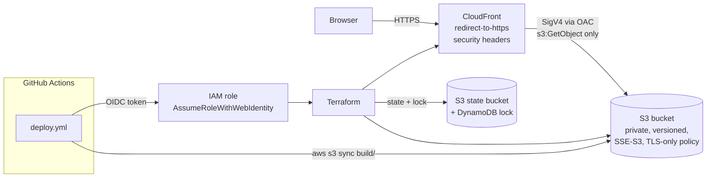

# aws-terraform-react-js

[](https://github.com/18-ashish-sharma/aws-terraform-react-js/actions/workflows/terraform.yml)
[](https://github.com/18-ashish-sharma/aws-terraform-react-js/actions/workflows/app.yml)


Terraform that hosts a React single-page app on **AWS**: the build sits in a **private S3
bucket** and is served only through **CloudFront** with **Origin Access Control (OAC)**,
HTTPS and AWS-managed security headers. GitHub Actions checks every change without cloud
credentials and deploys with **OIDC**, so no AWS access key is stored anywhere.

## Architecture



How a request is served:

- `/static/js/main.<hash>.js` is cached at the edge for up to a year (`Managed-CachingOptimized`);
  the file name changes whenever the content does.
- `/index.html` is never cached (`Managed-CachingDisabled`), so a new deploy is live at once
  without a cache invalidation.
- A deep link such as `/about` has no object in S3. S3 answers 403 (CloudFront has no
  `s3:ListBucket`, so a missing key looks forbidden) and CloudFront returns `index.html` with
  200, so React's client-side router can render the page.

## Repository layout

```
.
├── react-app/                      Create React App (React 18)
├── terraform/
│   ├── modules/static-site/        S3 bucket + CloudFront + OAC (reusable module)
│   │   ├── s3.tf                   bucket, public access block, encryption, versioning, lifecycle, policy
│   │   └── cloudfront.tf           OAC, distribution, cache + security-header policies
│   └── environments/
│       └── dev/                    Root module: provider, S3 backend, module call
├── .tflint.hcl                     tflint + AWS ruleset
└── .github/workflows/
    ├── terraform.yml               fmt, validate, tflint, checkov (PR + main, no credentials)
    ├── app.yml                     npm ci, test, build (PR + main)
    └── deploy.yml                  Manual: build -> plan -> approval -> apply -> s3 sync -> smoke test (OIDC)
```

A new environment is a copy of `environments/dev` with its own state key, so a `plan` in one
environment can never touch another.

## Prerequisites

- Terraform >= 1.6, AWS CLI v2, Node.js 20
- AWS credentials for an account where you can create S3, CloudFront and IAM resources
- An S3 bucket and DynamoDB table for remote state (one-time):

```bash
REGION=ap-south-1
STATE_BUCKET=tfstate-$(aws sts get-caller-identity --query Account --output text)-$REGION
aws s3api create-bucket --bucket "$STATE_BUCKET" --region "$REGION" \
  --create-bucket-configuration LocationConstraint="$REGION"
aws s3api put-bucket-versioning --bucket "$STATE_BUCKET" --versioning-configuration Status=Enabled
aws s3api put-public-access-block --bucket "$STATE_BUCKET" --public-access-block-configuration \
  BlockPublicAcls=true,IgnorePublicAcls=true,BlockPublicPolicy=true,RestrictPublicBuckets=true
aws dynamodb create-table --table-name terraform-state-lock --region "$REGION" \
  --attribute-definitions AttributeName=LockID,AttributeType=S \
  --key-schema AttributeName=LockID,KeyType=HASH --billing-mode PAY_PER_REQUEST
```

## Run locally

```bash
cd terraform/environments/dev
cp backend.hcl.example backend.hcl        # set your state bucket
cp example.tfvars dev.tfvars              # both copies are git-ignored

terraform init -backend-config=backend.hcl
terraform plan  -var-file=dev.tfvars -out=tfplan
terraform apply tfplan

# Build and upload the app
cd ../../../react-app && npm ci && npm run build
BUCKET=$(terraform -chdir=../terraform/environments/dev output -raw bucket_name)
aws s3 sync build/static "s3://$BUCKET/static" --delete --cache-control "public,max-age=31536000,immutable"
aws s3 sync build "s3://$BUCKET" --delete --exclude "static/*" --cache-control "no-cache"
open "$(terraform -chdir=../terraform/environments/dev output -raw website_url)"
```

A new CloudFront distribution takes a few minutes to reach every edge location.
`terraform destroy` in `environments/dev` removes everything (`force_destroy = true` in dev
empties the bucket first).

## CI/CD

| Workflow | Trigger | Credentials | What it does |
|---|---|---|---|
| `terraform.yml` | PR, push to `main` | none | `fmt -check`, `init -backend=false` + `validate` for the module and the root, `tflint`, `checkov` (SARIF to the Security tab) |
| `app.yml` | PR, push to `main` | none | `npm ci`, `npm test`, `npm run build`, uploads the build |
| `deploy.yml` | manual (`workflow_dispatch`) | OIDC | build -> `terraform plan` (saved plan) -> **approval** on the `dev` GitHub environment -> `apply` that exact plan -> `aws s3 sync` -> smoke test |

### One-time OIDC setup

GitHub issues a short-lived token per job; IAM trusts it through an OIDC identity provider,
so there is no access key to store or rotate.

```bash
aws iam create-open-id-connect-provider \
  --url https://token.actions.githubusercontent.com --client-id-list sts.amazonaws.com
```

Create a role (for example `gh-aws-terraform-react-js`) with this trust policy. The plan job
runs on `main` and the apply job in the `dev` environment, so both subjects are allowed:

```json
{
  "Version": "2012-10-17",
  "Statement": [{
    "Effect": "Allow",
    "Principal": { "Federated": "arn:aws:iam::123456789012:oidc-provider/token.actions.githubusercontent.com" },
    "Action": "sts:AssumeRoleWithWebIdentity",
    "Condition": {
      "StringEquals": { "token.actions.githubusercontent.com:aud": "sts.amazonaws.com" },
      "StringLike": { "token.actions.githubusercontent.com:sub": [
        "repo:18-ashish-sharma/aws-terraform-react-js:ref:refs/heads/main",
        "repo:18-ashish-sharma/aws-terraform-react-js:environment:dev"
      ] }
    }
  }]
}
```

Give the role permissions for S3 (the site bucket and the state bucket), DynamoDB (the lock
table) and CloudFront. Scope them to the resource names this repo creates rather than `*`.

In GitHub:

- **Repository variables**: `AWS_ROLE_ARN`, `AWS_REGION`, `TFSTATE_BUCKET`, `TFSTATE_LOCK_TABLE`
- **Environment** `dev`: add required reviewers and limit deployment branches to `main`

`deploy.yml` fails until this is done; `terraform.yml` and `app.yml` need nothing.

## Security notes

- **No credentials in the repo or in CI.** GitHub -> AWS uses OIDC. `*.tfvars`, `backend.hcl`
  and state are git-ignored.
- **Private origin.** All four S3 public-access-block settings are on, ACLs are disabled
  (`BucketOwnerEnforced`), and the bucket policy lets only this distribution read objects
  (`AWS:SourceArn` condition). OAC replaces the legacy Origin Access Identity.
- **Transport.** CloudFront redirects HTTP to HTTPS; the bucket policy denies any request
  without TLS (`aws:SecureTransport = false`).
- **Headers.** `Managed-SecurityHeadersPolicy` adds HSTS, `X-Content-Type-Options`,
  `X-Frame-Options`, `Referrer-Policy` and `X-XSS-Protection`.
- **Encryption and recovery.** SSE-S3 at rest; versioning keeps the previous build, and a
  lifecycle rule expires old versions after 30 days.
- Checkov findings that do not apply are skipped inline, each with its reason, next to the
  resource (WAF, access logging, custom certificate, replication, KMS).

## Cost notes

For a low-traffic site this is close to free. Check the AWS pricing calculator for current prices.

| Resource | Cost driver |
|---|---|
| CloudFront | Data transfer out and requests. The always-free tier covers 1 TB and 10 million requests a month. `PriceClass_200` leaves out the most expensive edge locations. |
| S3 | A few MB of storage plus GET requests from CloudFront (the edge cache absorbs most of them). Old versions expire after 30 days. |
| State bucket + DynamoDB | Pennies: on-demand lock table, a few KB of state. |

Adding WAF (about USD 5 a month plus rules) and CloudFront standard logs are the first
production additions; both are left out on purpose.

## Module reference

<!-- BEGIN_TF_DOCS -->
## Requirements

| Name | Version |
| ---- | ------- |
| <a name="requirement_terraform"></a> [terraform](#requirement\_terraform) | >= 1.6 |
| <a name="requirement_aws"></a> [aws](#requirement\_aws) | ~> 6.0 |

## Modules

No modules.

## Resources

| Name | Type |
| ---- | ---- |
| [aws_cloudfront_distribution.app](https://registry.terraform.io/providers/hashicorp/aws/latest/docs/resources/cloudfront_distribution) | resource |
| [aws_cloudfront_origin_access_control.app](https://registry.terraform.io/providers/hashicorp/aws/latest/docs/resources/cloudfront_origin_access_control) | resource |
| [aws_s3_bucket.app](https://registry.terraform.io/providers/hashicorp/aws/latest/docs/resources/s3_bucket) | resource |
| [aws_s3_bucket_lifecycle_configuration.app](https://registry.terraform.io/providers/hashicorp/aws/latest/docs/resources/s3_bucket_lifecycle_configuration) | resource |
| [aws_s3_bucket_ownership_controls.app](https://registry.terraform.io/providers/hashicorp/aws/latest/docs/resources/s3_bucket_ownership_controls) | resource |
| [aws_s3_bucket_policy.app](https://registry.terraform.io/providers/hashicorp/aws/latest/docs/resources/s3_bucket_policy) | resource |
| [aws_s3_bucket_public_access_block.app](https://registry.terraform.io/providers/hashicorp/aws/latest/docs/resources/s3_bucket_public_access_block) | resource |
| [aws_s3_bucket_server_side_encryption_configuration.app](https://registry.terraform.io/providers/hashicorp/aws/latest/docs/resources/s3_bucket_server_side_encryption_configuration) | resource |
| [aws_s3_bucket_versioning.app](https://registry.terraform.io/providers/hashicorp/aws/latest/docs/resources/s3_bucket_versioning) | resource |
| [aws_caller_identity.current](https://registry.terraform.io/providers/hashicorp/aws/latest/docs/data-sources/caller_identity) | data source |
| [aws_cloudfront_cache_policy.caching_disabled](https://registry.terraform.io/providers/hashicorp/aws/latest/docs/data-sources/cloudfront_cache_policy) | data source |
| [aws_cloudfront_cache_policy.caching_optimized](https://registry.terraform.io/providers/hashicorp/aws/latest/docs/data-sources/cloudfront_cache_policy) | data source |
| [aws_cloudfront_response_headers_policy.security_headers](https://registry.terraform.io/providers/hashicorp/aws/latest/docs/data-sources/cloudfront_response_headers_policy) | data source |
| [aws_iam_policy_document.app](https://registry.terraform.io/providers/hashicorp/aws/latest/docs/data-sources/iam_policy_document) | data source |

## Inputs

| Name | Description | Type | Default | Required |
| ---- | ----------- | ---- | ------- | :------: |
| <a name="input_app_name"></a> [app\_name](#input\_app\_name) | Short application name used in resource names (lowercase letters, digits and hyphens, 3-30 chars). | `string` | n/a | yes |
| <a name="input_environment"></a> [environment](#input\_environment) | Deployment environment. | `string` | n/a | yes |
| <a name="input_force_destroy"></a> [force\_destroy](#input\_force\_destroy) | Allow 'terraform destroy' to delete the bucket even when it still holds objects. Keep false outside throwaway environments. | `bool` | `false` | no |
| <a name="input_noncurrent_version_retention_days"></a> [noncurrent\_version\_retention\_days](#input\_noncurrent\_version\_retention\_days) | Days to keep previous versions of objects in the bucket (lets you roll back a bad deploy) before they expire. | `number` | `30` | no |
| <a name="input_price_class"></a> [price\_class](#input\_price\_class) | CloudFront price class. PriceClass\_200 includes India and most of Asia and Europe; PriceClass\_All adds South America and Australia. | `string` | `"PriceClass_200"` | no |
| <a name="input_tags"></a> [tags](#input\_tags) | Extra tags for every resource in the module. | `map(string)` | `{}` | no |

## Outputs

| Name | Description |
| ---- | ----------- |
| <a name="output_bucket_arn"></a> [bucket\_arn](#output\_bucket\_arn) | ARN of the S3 bucket. |
| <a name="output_bucket_name"></a> [bucket\_name](#output\_bucket\_name) | S3 bucket holding the built React app (upload target for 'aws s3 sync'). |
| <a name="output_cloudfront_distribution_id"></a> [cloudfront\_distribution\_id](#output\_cloudfront\_distribution\_id) | CloudFront distribution ID (for a manual invalidation; deploys do not need one because index.html is never cached). |
| <a name="output_cloudfront_domain_name"></a> [cloudfront\_domain\_name](#output\_cloudfront\_domain\_name) | CloudFront domain name, e.g. d1234abcd.cloudfront.net. |
| <a name="output_website_url"></a> [website\_url](#output\_website\_url) | HTTPS URL of the site. |
<!-- END_TF_DOCS -->
